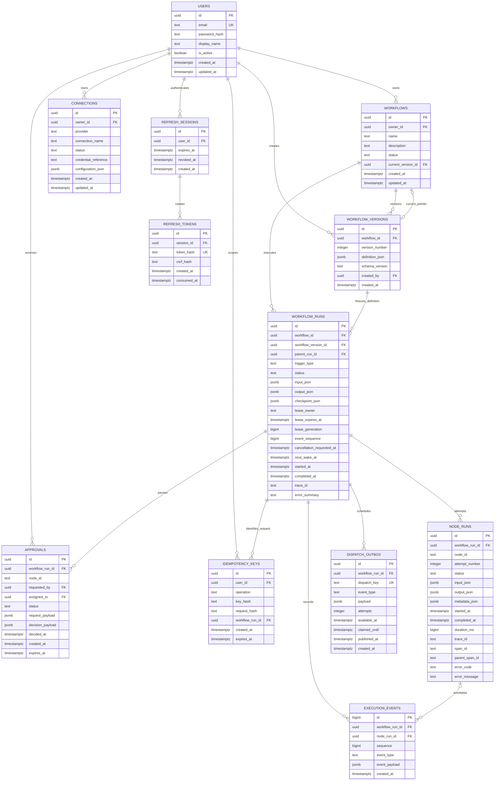

# Proposed database ER diagram

Phase 0 target ER design. USERS, WORKFLOWS, and WORKFLOW_VERSIONS were implemented in revision 0001. Phase 3C revision 0002 adds REFRESH_SESSIONS (families) and REFRESH_TOKENS (retained one-use hash history); Phase 5A revision 0003 adds WORKFLOW_RUNS, NODE_RUNS and EXECUTION_EVENTS, with status revision, exact-version/attempt identity and ordered events. Lease/checkpoint/telemetry and other future fields in this target diagram remain planned; the implemented field inventory is in [execution persistence notes](../learning-notes/execution-persistence.md). Other entities remain planned. See [refresh-session notes](../learning-notes/refresh-sessions.md). See [model/migration notes](../learning-notes/migrations.md) for verified scope.

## Reading the relationships

- **One-to-many:** one user owns many workflows; one workflow has many versions/runs; one run has many node-attempt rows, events, and approval records.
- **Optional one-to-one pointer:** a workflow has zero or one current version; a version is current for at most its own workflow. That pointer is separate from the one-to-many version history. It is nullable only during initial workflow creation or a deliberately versionless draft.
- **Exactly one referenced version per run:** an immutable version can be used by many runs. A composite foreign key verifies that the version belongs to the run's workflow.
- **Optional event association:** run-wide events have no node attempt. Node events reference an attempt belonging to the same run.
- **User roles in approvals:** the diagram shows the assignee relation. `requested_by` is also a user FK; service-created requests retain the initiating authorized user, not a fabricated agent user.
- **Infrastructure tables:** refresh sessions support revocation, dispatch outbox supports commit-safe job delivery, and idempotency keys deduplicate API run requests. These are justified additions to the eight application tables, introduced with Phases 3, 6 and 5 respectively.
- **LangGraph tables:** deliberately omitted from the application ERD. Its maintained PostgreSQL checkpointer owns separate tables/schema when introduced in Phase 8; node metadata records the thread correlation.

This is a relational design, not a request to create all tables in the first migration. See [schema decisions](schema.md) for constraints, indexes, migration order and transaction rules.
