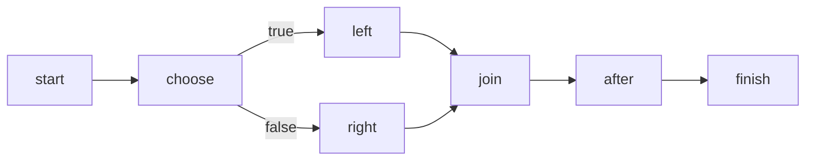

# Phase 4D — authoritative graph validation and compilation

Current follow-on: [Phase 5C branch execution](branch-execution.md) adds conditions/calculators, selected-route merges and persisted completion skips. All six registered types are now execution-ready. Scope and verification below record the original increment.

Current follow-on: [Phase 5B first runner](first-runner.md) implements actual manual/transform/end execution. Validation/catalog readiness is now true for those supported graphs/types; figures below record original Phase 4D verification.

Verified 2 November 2026. The backend now validates an owned saved workflow version or unsaved candidate and builds a deterministic internal plan. It does not execute, save, activate or change the workflow. All node execution readiness remains false. The next increment is Phase 5A: persisted runs, attempts, events and legal state transitions; the first real runner follows in 5B.

## API and read-only flow

POST /api/v1/workflows/{workflow_id}/validate requires the same active-user Bearer JWT as workflow CRUD. Send one explicit JSON body:

| Body                                                                      | Selected definition                                                   |
| ------------------------------------------------------------------------- | --------------------------------------------------------------------- |
| `{}`                                                                      | The current immutable version pointer read from the owned workflow.   |
| `{ "version_id": "<uuid>" }`                                              | That exact saved version, provided it belongs to this owned workflow. |
| `{ "definition": { "schema_version": "1.0", "nodes": [], "edges": [] } }` | An unsaved candidate; this empty example is semantically invalid.     |

The body is required. Both selectors together, explicit null, extra fields and malformed/beyond-limit definition envelopes return the existing safe 422 envelope. Missing/unowned workflows and mismatched historical versions share generic 404. A versionless current draft returns 200 valid false with NO_SAVED_DEFINITION. Archived workflows/history can be inspected: validation neither restores nor activates them. Source is candidate or saved; workflow_version_id identifies the exact snapshot used, or null for candidates/versionless state. A concurrent new save does not switch a validation request to the newer snapshot.

For well-formed envelopes, semantic failures return 200 with valid false, plan null, and static diagnostics. Successful compilation returns valid true, an empty issue list, and a plan summary. For example:

```json
{
  "workflow_id": "<owned-workflow-uuid>",
  "workflow_version_id": "<selected-version-uuid>",
  "source": "saved",
  "valid": true,
  "execution_ready": false,
  "issues": [],
  "issues_truncated": false,
  "plan": {
    "entry_node_id": "start",
    "node_count": 3,
    "edge_count": 2,
    "topological_order": ["start", "step", "finish"],
    "terminal_node_ids": ["finish"]
  }
}
```

Each issue has a code, code-owned message and structural path such as nodes.2.config or edges.1. It never quotes an offending config, business key, node ID, validator text or exception. The report holds at most 100 issues and sets issues_truncated when that stage finds more. Validation is staged; it stops before later checks when the necessary structure/config is invalid, so a report is not an exhaustive list of every possible downstream issue. Unexpected failures remain safe 500; unavailable auth/storage remains safe 503. Successful reports are no-store and carry the usual request-ID header.

The service authorizes the workflow, selects/copies one definition, and closes its read Session before CPU compilation. No unit_of_work, INSERT, UPDATE, pointer change or version append is involved. Existing draft-saving semantics remain permissive: an unfinished or unsupported graph can still be saved and inspected, but cannot produce a valid compiled plan. No validation flag is persisted, and any future run must recompile the exact authorized saved version rather than trusting a previous report.

## Supported DSL and topology

The storage envelope still has schema_version "1.0", nodes/edges arrays, 500/2000 entry limits, finite native JSON, depth 32 and compact UTF-8 size 256 KiB. The compiler accepts only root keys schema_version, nodes, edges and optional metadata (JSON object). Arbitrary saved root extensions such as EditorState continue to round-trip in storage, but are not accepted for compilation; put presentation extensions under metadata. Unknown semantic fields are rejected rather than silently interpreted. Metadata does not affect the plan.

A node requires id, type and config. Optional label (max 200), position (finite x/y within ±10000000) and input_mapping are supported. Extra/camelCase node fields are rejected. IDs are 1–64 ASCII characters: a letter/underscore followed by letters, digits, underscore or hyphen, matching the registry's reference identifiers. Only manual, transform, condition, calculator, merge and end have supported typed configs in this increment.

An edge requires unique id, source and target, with the same ID grammar. Optional source_handle defaults to default; conditions must explicitly provide true and false routes. Optional label is bounded to 200. No target_handle, expression or camelCase alias is supported. Missing endpoints, self edges, repeated IDs and repeated source/handle/target routes are invalid.

Topology rules:

- Exactly one manual entry, with no incoming edge. At least one end node.
- Every nonmerge node except the entry has exactly one incoming route. A merge has at least two incoming routes, counted as edges.
- Manual/transform/calculator/merge each have exactly one default outgoing edge. Condition has exactly one true and one false edge. End has no outgoing edges.
- Every node is reachable from the entry. The entire graph is acyclic, including disconnected components.
- Branches may terminate at distinct ends or reconverge through explicit merge nodes. Nested exclusive branches are supported; implicit convergence into an ordinary node and parallel fan-out are rejected.

True and false can both route directly to the same merge: there are two incoming alternatives, not two concurrently active tokens. No paired/nested branch naming convention is required. With a single entry token and exclusive routes, a merge denotes convergence of the chosen path, not a parallel join. The runner will implement routing later. A DAG whose reachable nonterminals have their required outgoing routes must eventually reach an end; no sink can silently complete as another node type.

Kahn's topological sort processes the whole graph and uses a heap for deterministic identifier ordering. Equivalent node/edge array permutations produce the same immutable plan. The topological order includes both possible branches; it is a dependency order, not an instruction to execute every node.

## Output mappings and safe branch references

Optional input_mapping maps up to 100 literal top-level input keys (1–200 characters) to registry output references. Keys retain their case, spaces and dots as literal business keys. References use the bounded $.node_id.output.field grammar from [Phase 4C](node-registry.md). Condition field references and calculator operands with kind output participate in the same availability check. Path-looking comparison values, literal numbers and pick_fields names remain literals.



Here after can reference start or join, but cannot reference left or right: one of those branches will not have run. Merely checking that left is an ancestor would miss this error.

The compiler computes dominators: a node dominates another if every entry-to-consumer path passes through it. For the entry the set is itself; for each later node, intersect its parents' dominator sets and add itself. A reference source must be a strict dominator of its consumer, which also rejects missing, self, future and sibling references. The calculation considers paths reaching the consumer; a separate branch that already ended does not invalidate an otherwise available output on the surviving route.

Compilation proves node availability, not the existence/type/value of a nested output field. Actual dictionary-only resolution, missing keys, numeric types/ranges, zero division and result bounds remain runtime checks. A literal zero-divisor calculator config can compile; no arithmetic is attempted here. No eval, template interpolation, Python attribute access, network/model call or arbitrary code is introduced.

## Files and functions

- app/modules/workflows/graph_schemas.py defines strict GraphNode/GraphEdge/Position and ID/mapping bounds for compilation. These sit inside the permissive saved-draft envelope, not in the save path.
- validation_schemas.py defines the mutually exclusive selector request, frozen public diagnostics, bounded plan summary and consistent report schema. Its response validator prevents valid/plan/issues from disagreeing. Null selectors are rejected while omission remains meaningful.
- compiler.py validates the envelope, parses typed nodes/configs through the registry, checks edges/degrees/reachability/cycles, computes dominators and converts declared references into bindings. compile_workflow returns CompilationResult with either a plan or bounded static issues. Helper stages separate schema errors from topology and availability failures.
- CompiledWorkflow, CompiledNode, CompiledRoute and CompiledBinding are frozen dataclasses containing tuples and strings. Configs are validated canonical JSON strings, not mutable model/dict/list references. Presentation metadata is excluded from execution data. The compiler neither mutates nor retains mutable input containers.
- node_registry.py adds node_output_handles to read an immutable route tuple without rebuilding JSON Schemas or exposing adapters.
- validation_service.py adds WorkflowValidationService.validate: derive owner scope, pin an immutable current/historical UUID or copy the candidate, close the Session, compile and return only the safe public summary. It reuses repository owner filters and existing error handlers.
- api/v1/workflows.py adds the POST validation boundary; app/main.py updates the API description. The API now has 13 implemented operations across ten paths. No other endpoint, new dependency/configuration, database model or migration is needed; revision stays 0002.
- tests/unit/test_graph_compiler.py supplies 59 topology/config/reference/immutability/privacy cases. tests/api/test_workflow_validation_contract.py adds 23 HTTP schema/auth/OpenAPI cases; tests/integration/test_workflow_validation.py adds 13 real PostgreSQL ownership/snapshot/read-only/failure cases. Existing exact route inventories include the new path. A duplicate test-module basename was corrected before final verification by naming the API file with the existing _contract convention.

## Actual verification

Complete checker against real PostgreSQL: **560 passed**. Ordinary checker: **403 passed, 157 skipped**. Added 82 ordinary and 13 integration cases. Ruff lint/format passes 97 Python files, Pyright zero errors/warnings, locked offline synchronization passes. Prior authentication, migration/drift/round-trip, immutable-trigger, CRUD/rollback and concurrent-save checks remain green.

Coverage includes linear and early-terminal paths, nested diamonds/merges, same-target true/false merge routes, duplicate identity/connection/handle rejection, unreachable cycles, deterministic permutation order, unknown/extra fields, strict configs, dominator-safe versus branch-local/self/future/missing references, literal path-looking strings, frozen input-independent plans, static secret-free capped diagnostics and no arithmetic execution. API integration proves candidate/current/history selection, unchanged status/timestamps/pointer/history, two-user missing/unowned/version-membership privacy, inactive-user rejection, safe 503 recovery and exact old snapshot binding during a concurrent pointer advance. Independent local probes also accepted a 500-node chain and bounded diagnostics for a 2000-edge malformed graph; these are complexity probes, not production benchmarks.

Live Uvicorn with real registration/login verified saved and unsaved validation, semantic valid false, owner denial, continued unfinished draft saves, exact historical reports, zero read-only state changes, current/history validation across restart, archived inspection, 13 operations/ten paths, request-ID correlation, private key/password/token/config omission from logs and graceful shutdown. Only Database was overridden to a disposable migrated local test schema; the signing key was process-local. No private .env or development accounts/data were read/edited. Cleanup found zero random test schemas and zero public test tables; temporary server/factory/scripts/test container were removed and development PostgreSQL left running. Documentation formatting/relative links passed.

## Review and next increment

Next is Phase 5A: run/node-attempt/event migrations and state transitions. Phase 5B introduces the first controlled manual → transform → end runner, before background workers, Groq and frontend API integration. Validation does not yet provide actual run outputs, retries, approvals or metrics. The [real backend walkthrough](../real-backend-walkthrough.md) shows how to call the new endpoint through Swagger and lists all remaining modules.

Exercise, without a supplied solution: build nested exclusive branches with an early-terminal arm and a calculator on a surviving route. Predict which output reference is guaranteed available, then test validation and confirm both attempts leave saved state/history unchanged. Use isolated fixtures, not development data.

Review questions, one at a time:

1. Why is an ancestor check insufficient for a reference after an exclusive merge?
2. Why does valid true still return execution_ready false?
3. Why does a future run need to recompile its exact saved version instead of trusting an earlier report?
4. Why is topological order different from the route a particular run executes?
